# Kumul Wholesale: a Microsoft Fabric data platform


**Video: a quick tour of the finished Power BI report (1 minute, no sound)**

https://github.com/user-attachments/assets/0a5c28bd-5eb1-4f77-8b42-489be0bf307e


This project is a full analytics platform built in Microsoft Fabric for Kumul Wholesale, a made-up food and supplies distributor that trades in Australia (in AUD) and Papua New Guinea (in PGK).

Data starts in an on-premises SQL Server database, moves through a lakehouse where it gets cleaned, lands in a warehouse as a star schema, and ends up in a two-page Power BI report.

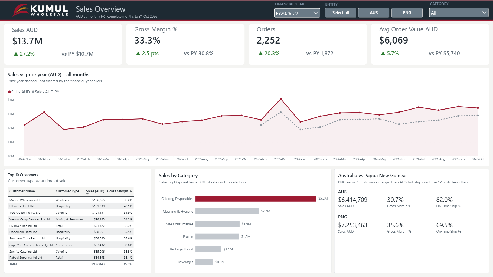

**Tools used:** SQL Server, on-premises data gateway, Fabric Copy jobs and pipelines, lakehouses, PySpark notebooks, Fabric Warehouse (T-SQL), Direct Lake semantic model, DAX, Power BI (PBIP), Git integration, and Claude Code with the Power BI authoring plugin.

---

## The business

Kumul Wholesale has two companies running off one ERP system:

| Company | Currency | Warehouses |
|---|---|---|
| Kumul Wholesale Pty Ltd (AUS) | AUD | Brisbane DC, Cairns Depot |
| Kumul Wholesale (PNG) Ltd (PNG) | PGK | Port Moresby DC, Lae Depot |

The business wants one place to see sales, margin and shipping performance for both companies, all in AUD. Staff in each company should only see their own company's data.

The source database (`KumulERP`) holds two years of made-up history, from November 2024 to October 2026. That's about 400 customers, 56 products, 12,000 orders and 42,000 order lines, with busier Decembers and steady growth over time.

I also added 10 data problems on purpose, so the cleaning step had real work to do. There's also a stored procedure, `sales.usp_SimulateBusinessDay`, that pretends a day of business has happened. It adds new orders, ships old ones and changes a couple of customers. I used it to prove that the pipeline only picks up what has changed.

---

## How it fits together

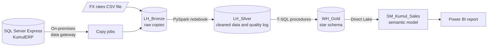

One pipeline (`PL_Kumul_Orchestration`) runs everything in about 5 minutes. The two copy jobs run at the same time. The cleaning notebook waits for both to finish, then the gold load runs last.

| Pipeline run | Customer history (SCD2) |
|---|---|
| 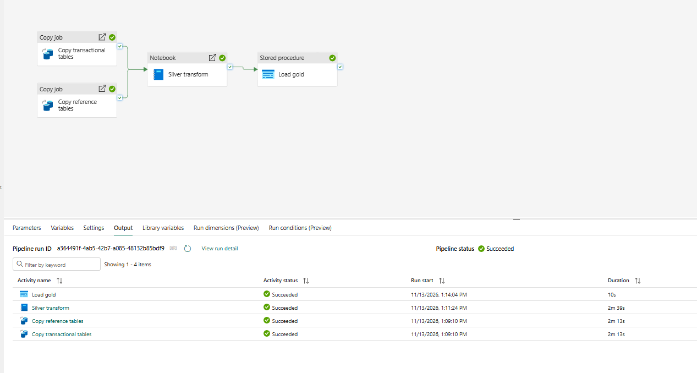 | 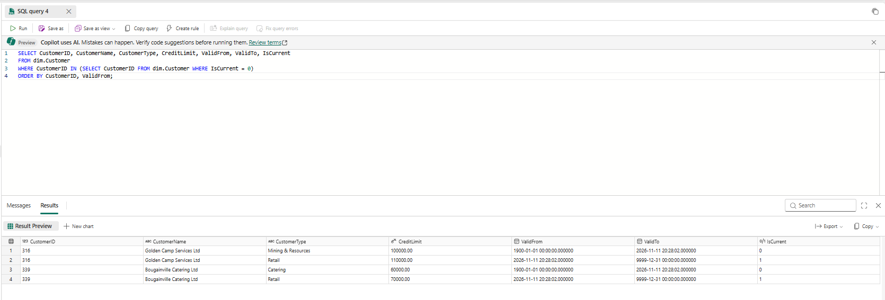 |

---

## Why I built it this way

**Lakehouse for the early stages, warehouse for the final model.**
The lakehouse is good for landing raw data and cleaning it with Spark. The warehouse is good for the business-facing model because it has full T-SQL, stored procedures and transactions. Transactions mean a report never sees a half-loaded table.

**Only copy what has changed.**
Orders, order lines, customers and products are copied incrementally. Each run only picks up rows whose `ModifiedAt` date has moved on since the last run. Rows are then matched on their ID and updated in place. So when an order goes from Open to Picking to Shipped, there is still only one row for it, not three.

The two small reference tables (companies and warehouses) are just copied in full each time. They only have a few rows, so there's no point doing anything clever.

**Keep the source system safe.**
The gateway only makes outgoing connections, so nothing on the source network is opened up. Fabric reads the database with a login that can only read, never change, anything. Pipeline steps sign in with the workspace's own identity rather than my personal account where possible.

**Keep customer history.**
If a customer's type, city or credit limit changes, the old version is closed off and a new one is added. Each sale stays linked to what the customer looked like when the order was placed. That way last year's report still shows last year's picture. Name changes just overwrite, because a corrected spelling should apply everywhere.

**Convert everything to AUD.**
PNG sales are converted using monthly exchange rates from a CSV file, like one a finance team would supply. Database tables land straight into lakehouse tables, while files land as files first and get tidied up in the notebook.

**Don't show numbers that mislead.**
- Sales figures leave out cancelled orders.
- The report only shows complete months, so a part month is never compared with a full one.
- Year-on-year change is hidden when last year doesn't have a full set of data. The data starts in November 2024, so comparing FY2025-26 with FY2024-25 would have shown growth of 79.9%, mostly because months were missing. The cards show "PY incomplete" instead.

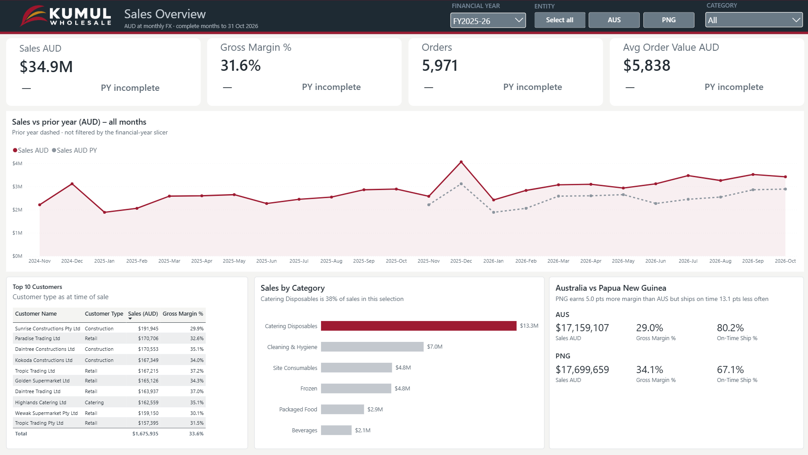

---

## Bronze: getting the data in

Two copy jobs bring the database tables into `LH_Bronze` through the gateway.

To test the incremental copy, I simulated a day of business and ran the pipeline again. Order headers went from 11,934 to 11,959, which is exactly the 25 new orders. Orders that had shipped were updated, not duplicated.

| Before | After |
|---|---|
| 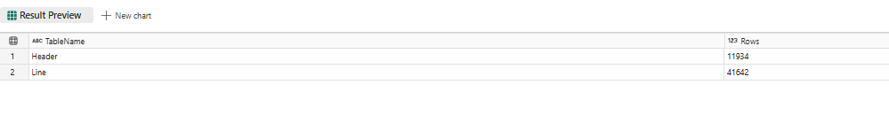 | 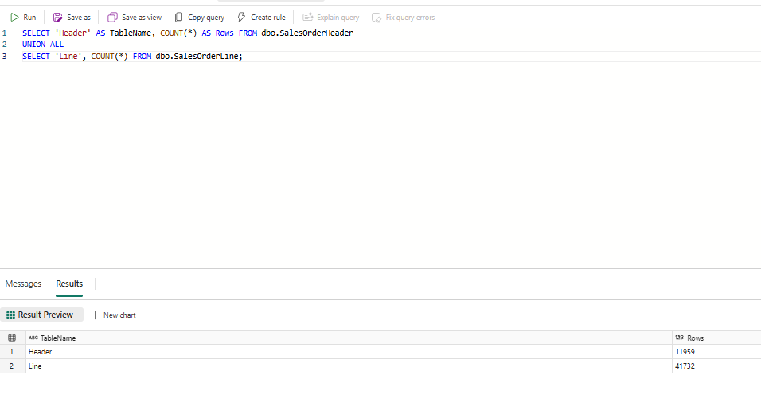 |

---

## Silver: cleaning the data

A PySpark notebook (`NB_Silver_Transform`) rebuilds the silver tables from bronze each time it runs. Every problem it finds is written to a `DataQualityLog` table, with a new set of rows each run, so you can see data quality over time.

The last step in the notebook tells the lakehouse's SQL endpoint to refresh. Without it, the gold load can read old data before the endpoint catches up.

| # | Problem I planted | What the notebook does |
|---|---|---|
| 1 | Customer names in capitals or with extra spaces | Trims and fixes the case |
| 2 | Cities spelt different ways (`POM`, `Pt. Moresby`, `LAE`) | Sets one standard spelling |
| 3 | Missing customer type | Sets it to `Unknown` rather than dropping the customer |
| 4 | Duplicate customers | Matches them by company and cleaned-up name, keeps one, and moves their orders across |
| 5 | Order status in mixed case | Standardises it |
| 6 | Shipped orders with no ship date | Fills it from the last-updated date and flags it |
| 7 | Missing currency | Fills it from the company's home currency |
| 8 | Order dates typed as the 2050s | Uses the date the system created the order instead, and flags it |
| 9 | Returns entered as negative quantities | Keeps them and flags them as returns |
| 10 | Products with a $0 price | Flags them rather than guessing a price |

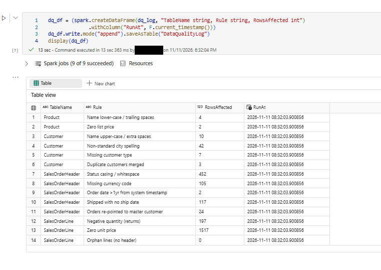

---

## Gold: the star schema

`WH_Gold` is built with T-SQL.

- **Dimension tables:** dates (including Australian financial years), companies, warehouses, products and customers (with history). There's also an "Unknown" customer, so a sale never drops out of a report just because its customer can't be matched.
- **Fact table:** one row per order line, with sales in local currency and AUD, cost, margin, days to ship and a late-shipment flag.
- **Load procedures:** one loads the dimensions, one loads the fact table inside a transaction, and one runs both. The pipeline calls that last one. Row counts are logged after each load.

| Row counts | Sales by company, local currency vs AUD |
|---|---|
| 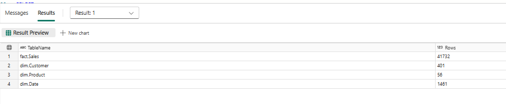 | 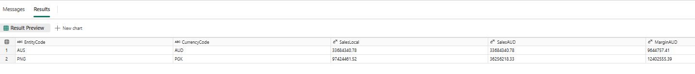 |

The fact table matches the cleaned order lines exactly (41,732 rows), with no unmatched customers and no missing exchange rates.

To test the whole chain and the customer history, I simulated a second day of business. The fact table grew from 41,732 to 41,802 rows. Two customers who were reclassified each ended up with a closed old version and a new current version, and the dates line up with no gaps.

---

## The semantic model

`SM_Kumul_Sales` uses Direct Lake, which means it reads the warehouse tables directly. It's as fast as an import model, but there's no scheduled refresh to manage.

**Measures organised in folders**

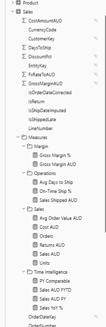

- Measures are grouped into folders and have descriptions, so they're easy to find and understand.

**Star schema**

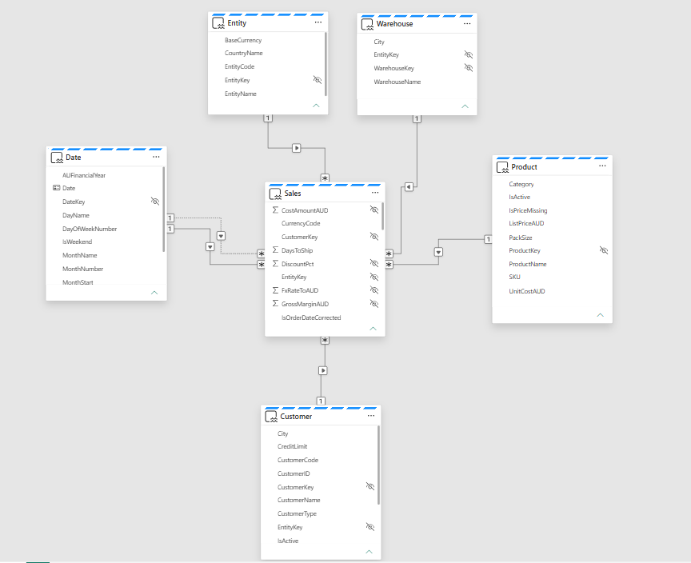

- A standard star schema. Every dimension connects only to the fact table.
- Two links to the date table, one for order date and one for ship date. The ship date link is switched off by default and only turned on inside the measures that need it.

**Security and access**

- Two security roles, `AUS team` and `PNG team`, limit each company's staff to their own data. The filter covers companies, customers and warehouses, not just companies. Otherwise staff could still see the other company's customer names in a filter list.
- The model reads data through a fixed connection, so people viewing the report don't need access to the warehouse itself.

---

## Checking the numbers

I checked each layer against something independent rather than trusting it.

| Check | Result |
|---|---|
| Bronze row counts vs SQL Server | Exact match |
| Gold fact rows vs cleaned order lines | Exact match (41,732) |
| Report sales and order counts vs a direct SQL query | Exact to the dollar |
| Report measures vs what the test data should produce | Days to ship 3.0 (AUS) and 5.9 (PNG). On-time 81.0% and 67.3%. PNG margin higher than AUS. All as expected. |

| Report | SQL |
|---|---|
| 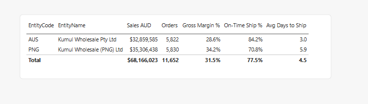 | 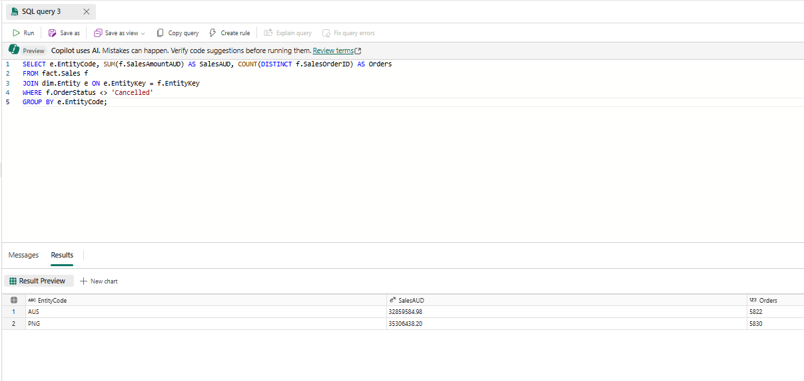 |

**A bug these checks caught.** My first on-time measure showed 84.2% and 70.8% when the test data said it should be about 80% and 67%. In DAX, a blank value counts as equal to FALSE when you use `=`, so orders that hadn't shipped yet were being counted as "on time". Using `==` instead, which treats blanks properly, fixed it.

---

## The report

The report holds no data of its own. It connects live to the semantic model, so all the logic lives in one place. It's saved as a Power BI project, so every page and visual is a text file that can go into source control. The filters stay in step across both pages, and the report always opens on the intended default view.

**Sales overview:** summary cards with year-on-year change, monthly sales against last year, sales by category, top customers, and a comparison of the two companies. The one-line takeaways under two of the visuals are calculated with DAX, so they stay correct whatever filters you pick.

**Operations:** on-time shipping by month and company, average days to ship by warehouse, how long orders take to ship compared with each company's target, and a warehouse performance table.

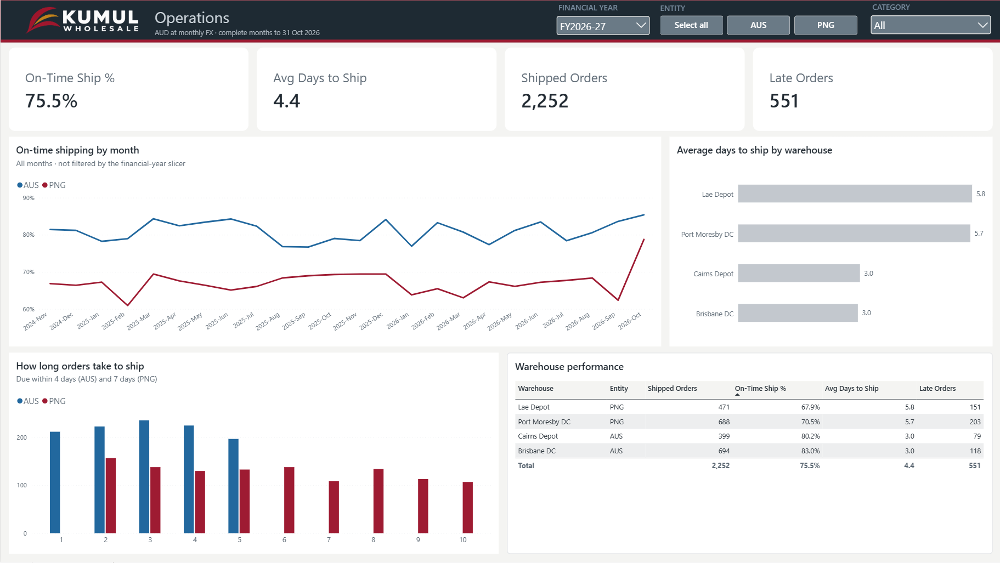

> The last month's on-time rate looks high because the test procedure ships every waiting order straight away. That's a quirk of the test data, not a real improvement.

The colour theme is based on the PNG flag, and I checked it for colour-blind readability and contrast.

---

## Using an AI agent for part of the build

I built the Operations page with an AI agent: Claude Code running in VS Code, using Microsoft's Power BI authoring plugin. I gave it a written spec, then checked and fixed the result myself.

- Before building, it asked me to confirm some table and column names.
- It then built all 13 visuals in about 6 minutes.
- It listed 7 places where it had to change or work around the spec. One of them caught a mistake in my spec: copying the Sales card's "millions" format would have broken the percentage and count cards.
- I fixed 3 small things by hand (a number format, table headings and filter syncing) and checked the numbers against known values.

| What it built | What it couldn't do exactly |
|---|---|
| 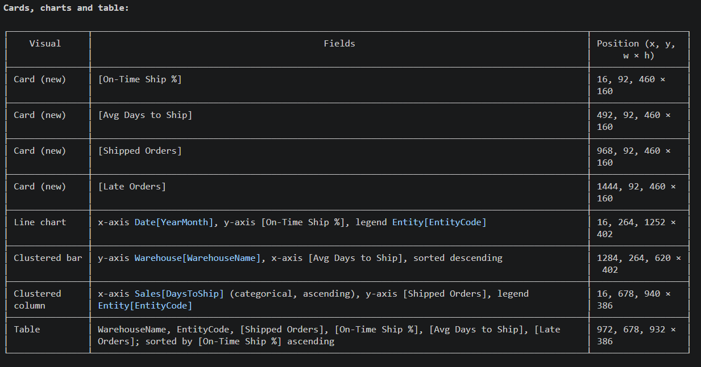 | 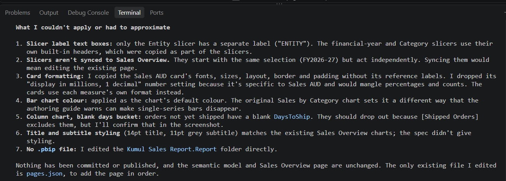 |

I used AI help across the rest of the project too. My part was deciding how it should work, making the trade-offs, checking every layer against independent numbers, and working through the problems described here.

---

## Things I learned along the way

- Spark saves table names in lower case, and Fabric Warehouse cares about case. So the gold queries had to use lower-case names for the silver tables.
- A lakehouse's SQL endpoint can lag behind the data. That's why the notebook forces a refresh before the gold load.
- In DAX, `=` treats a blank as equal to FALSE. Use `==` when you need to tell them apart.
- Power BI Desktop and the browser draw text slightly differently. Leave some spare room in visuals and always check the published version.

---

## What I'd do differently for a real client

- Security that looks up each user's company from a table, instead of one fixed role per company
- Service accounts for every connection, so nothing depends on one person's login
- Separate development, test and production workspaces, with deployment pipelines between them
- A way to catch deleted rows in the source, which date-based incremental loads can't see
- Only reprocessing changed rows in the cleaning step, rather than rebuilding everything
- Alerts when a pipeline fails or data quality drops

---

## What's in this repo

```
fabric/              Fabric workspace items, exported with Git integration:
                     pipeline, copy jobs, notebook, lakehouses, warehouse,
                     semantic model and report
sql/                 01_KumulERP_seed.sql (source database, test data, simulator)
                     03_gold_warehouse.sql (gold tables and load procedures)
data/                fx_rates_monthly.csv (made-up exchange rates)
docs/screenshots/    Screenshots for each stage
```

---

## Other projects

- **[Self-Writing Sales Dashboard](https://github.com/solvedbygling/power-platform-portfolio)**  
  A Power BI report that writes its own executive summary, using Power Automate and an LLM.

---

*All data is made up. Kumul Wholesale is not a real company.*
